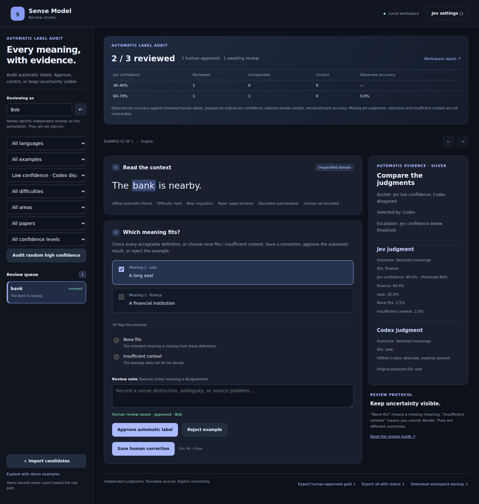

# Automatic pilot verification — 2026-11-15

This receipt records software behavior, not benchmark accuracy or dataset quality.
The examples used in automated and live smoke checks are authored software fixtures.

Final local checks: **134 Python tests passed**, both Playwright browser tests
passed, Ruff/lock/diff checks passed. Node checks passed (2 tests; the optional
artifact parity check was skipped without its fixture). Existing ONNX export
deprecation/tracing warnings remain.

## Verified paths

- Offline generation tests: exact Unicode spans, language and quota enforcement,
  fixed dictionary candidates, Google Scholar response parsing, authentic source
  substring checks, input hashes, resumable checkpoints and incomplete outputs.
- Offline labeling tests: Jev reported confidence at/below threshold, missing
  confidence, independent Codex judgments, abstentions, malformed answers,
  bounded retries/concurrency, cache reuse/invalidation, operational failures,
  cancellation, and stale human-review removal on relabeling.
- Integration: actual PDF extraction; generation → automatic labeling → SQLite
  import → single-human approval → canonical reviewed JSONL → existing evaluator.
- Browser: real local HTTP server and SQLite store with only the paid provider
  mocked. Both legacy manual review and automatic review pass, including filters,
  random high-confidence audit, multi-ID correction, rejection/abstention,
  exports, key persistence without disclosure, and mobile overflow checks.
- Packaging: wheel includes new pipeline modules and web assets; source archive
  includes both scripts and the plan documentation.

## Live Codex checks

Codex CLI 0.169.0, default `gpt-6-luna`, existing local CLI authentication:

1. Shared runner returned structured JSON with execution/integration features
   disabled and an ephemeral read-only working directory.
2. The actual second-judge schema returned a valid supplied sense ID for an
   authored bank/river fixture.
3. The actual generation script selected one authentic passage from a local
   authored text fixture. Validation rejected a wrong-count response and the
   bounded retry succeeded. The generation schema now additionally constrains
   the response count and candidate pool IDs directly. A second live generation
   run with these constraints succeeded on the first attempt and the console
   entry point exited successfully.

No real Jev key or Scholar key was supplied for these checks. Their HTTP adapters
were tested with mocked responses; this does not establish live provider billing,
quota, accuracy, or availability for this account. The home config was created
with blank credentials and owner-only permissions. No real paper corpus or
reviewed 1,000-example English/Portuguese benchmark was produced by these tests.

## Reproduce

```sh
uv sync --frozen --extra train --extra export --extra dev --extra pilot
uv run ruff check src tests scripts
uv run pytest -q
npm ci --prefix web-tests
cd web-tests
npx playwright install chromium
npm test
```


