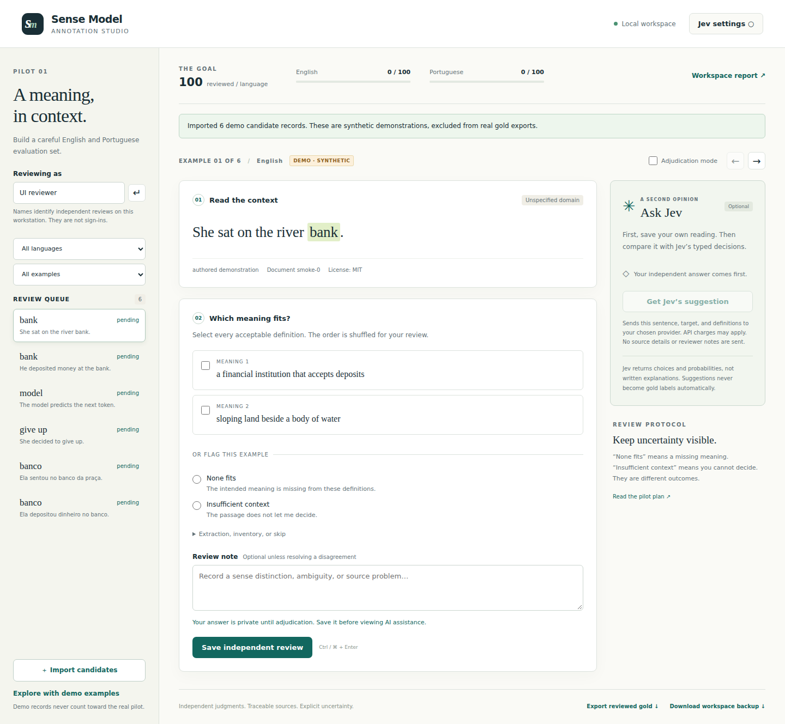

# Run the annotation pilot

The complete research protocol and acceptance criteria are in [pilot-plan.md](pilot-plan.md).
This UI is optional local tooling in the model repository; it is not a public
hosted service and never loads model weights to annotate examples.

```sh
uv sync --extra dev
uv run wsd annotate --open
```

Open http://127.0.0.1:8765 . The default SQLite workspace is
`.annotation/workspace.sqlite` (ignored by Git). Quit with Ctrl+C. To choose a
workspace/port or preload candidates:

```sh
uv run wsd annotate --workspace /path/to/workspace.sqlite --port 8765 --import-file /path/to/candidates.jsonl
```

1. Read the protocol and acquire a pinned local dictionary and source documents.
   See [pilot-collection.md](pilot-collection.md) for deterministic candidate collection.
2. Set your reviewer name. Names distinguish independent people; renaming yourself
   does not create independent scientific review. This is a trusted local workspace.
3. Import prepared JSONL. Existing gold labels are stripped for blind review.
   Demo examples are explicitly synthetic; they never count toward real pilot goals.
4. Choose all acceptable meanings, or none fits, or flag insufficient context,
   extraction or dictionary problems. Save your independent first vote.
5. Optionally open Settings and enter your TypeSafe or OpenRouter API key, choose
   its matching provider and model, then request Jev assistance. Only the example
   sentence/target/language and dictionary definitions go to that provider.
   Calls are billed by the provider; there is no automatic background labeling.
6. Jev returns typed choices and scores, not generated explanations. Its suggestion
   is not gold. Your initial vote remains preserved if you revise your final vote.
7. A second person uses their own reviewer name for independent blind annotation.
   Then adjudicate agreements/disagreements; supply notes for disagreements and
   ambiguous accepted answers. Flagged examples cannot silently become none-fits.
8. Export gold JSONL and its manifest; download an audit backup regularly. Store
   backups outside the public repository. SQLite/key session memory are local.

## API key handling

Enter keys only in the password field in Settings. The browser sends the key to
the loopback server; the input is cleared, the server stores it only in the
expiring browser session memory, and Clear key removes it. Reloading the page
retains the same live server session; restarting the server or expiry loses it.
Keys are not saved in browser localStorage, SQLite, exports, URLs, or logs.
There is no need to paste a key into chat, a command, or a source file.
Each browser session is separate. A selected provider receives only its own key;
custom endpoint URLs and redirects are not supported.

Live Jev calls require your key entered locally. Automated tests mock the official
System One response shape, so tests neither need a key nor consume paid usage.
See https://docs.typesafe.ai/api/system-one.md for the provider contract.

## Pilot execution and handoff

First review 20 examples in each language to check dictionary coverage, agreement,
and annotation time. Correct protocol problems before finishing the target 100
per language. The pilot is a development set. Do not repeatedly tune against a
future frozen test set. Report real accepted examples, independent reviewer
counts, document/lemma/domain mix, genuine none-fits, disagreements, assistance
exposure, answer revisions, source licensing, provider model versions and usage.

The interface makes annotation possible; it does not pretend that authored demos,
AI suggestions, or one person's two aliases constitute completed human labels.

Label-bearing downloads are guarded: finish your own initial votes on the
records disclosed before exporting gold or downloading review history. Aggregate
label/flag/agreement details are also hidden when they could unblind your review.
The SQLite workspace saves continuously even while a backup download is blocked.
The workspace owner can still inspect local files directly; this protects the
review workflow, not against a malicious user with filesystem access.



The screenshot uses authored demo records. See [verification](pilot-verification.md)
for the tests and their limits.
